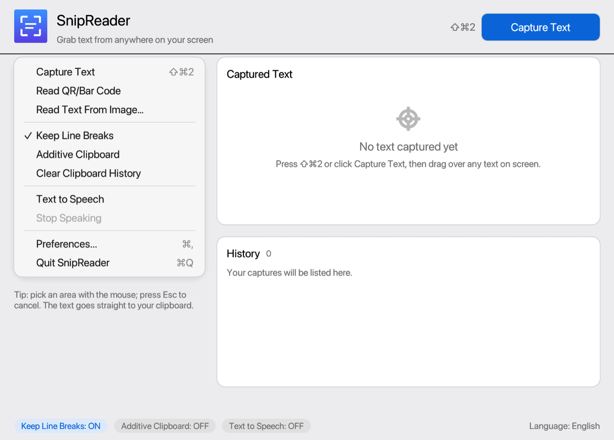
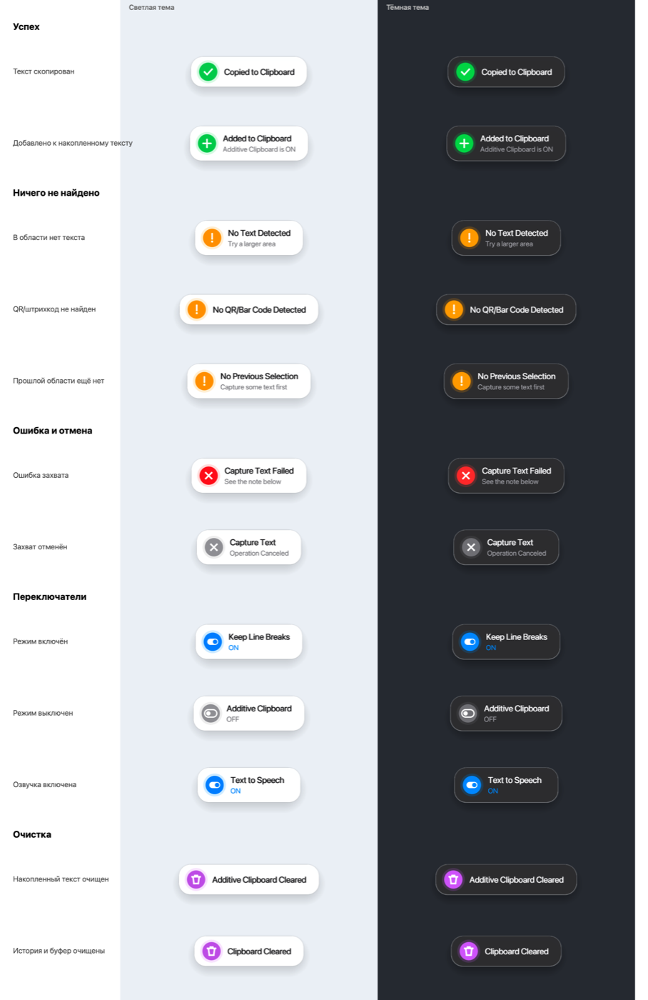
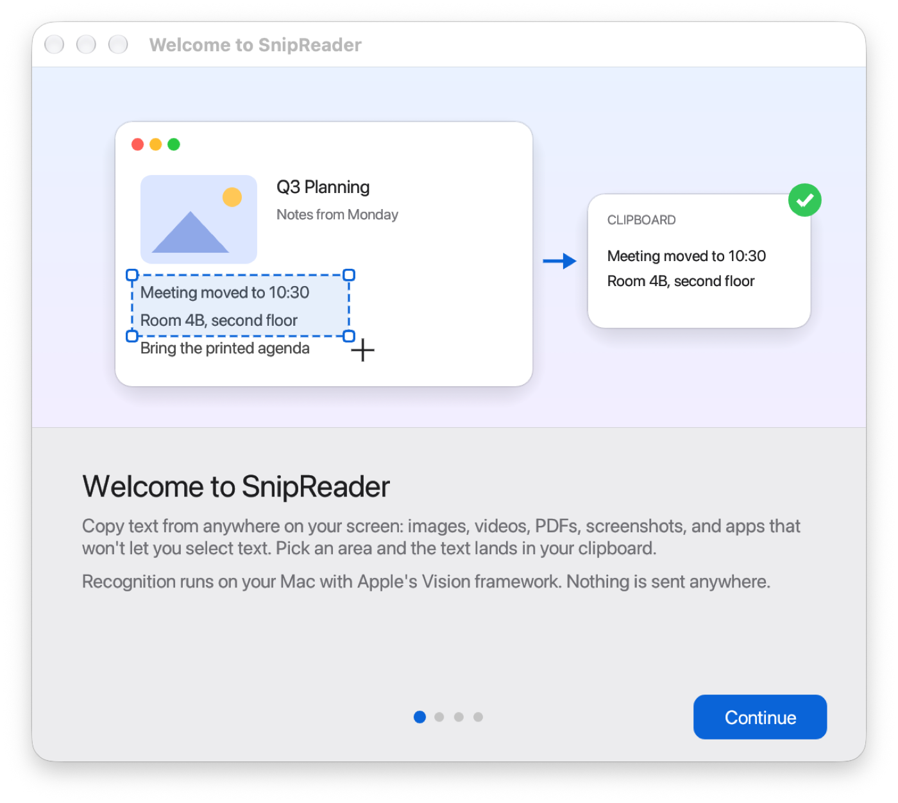
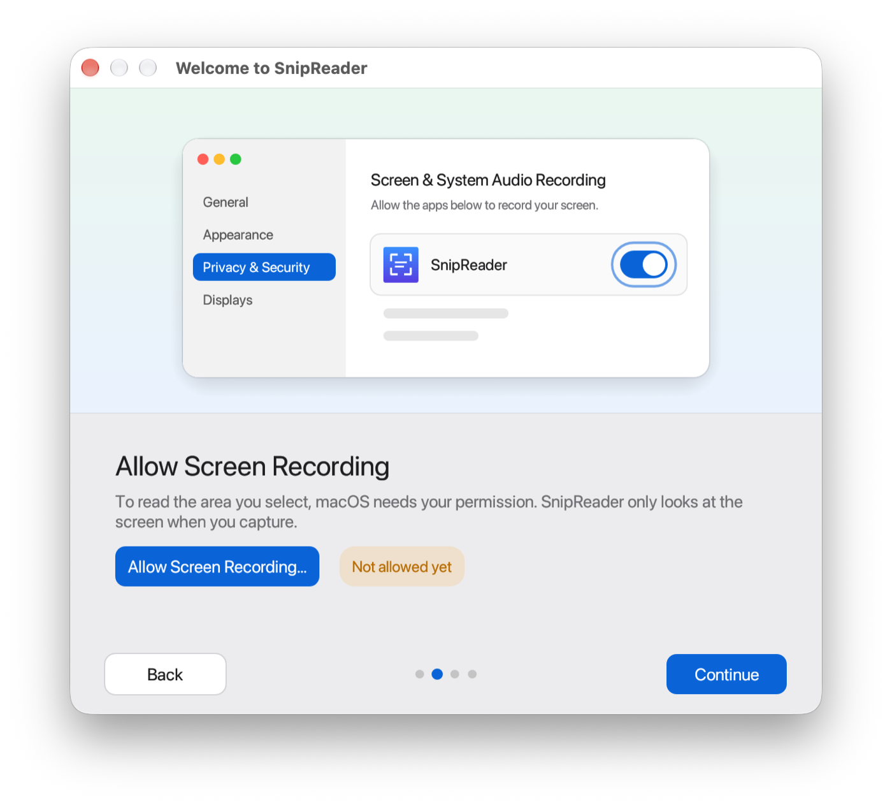
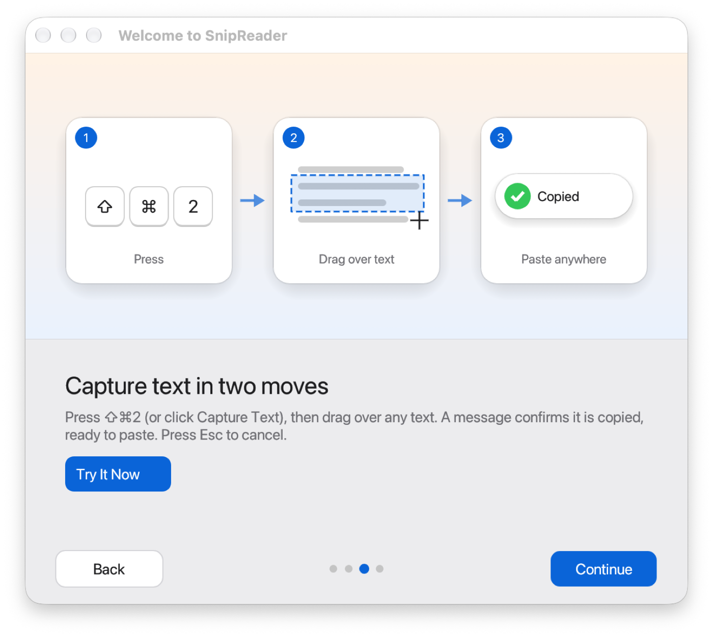
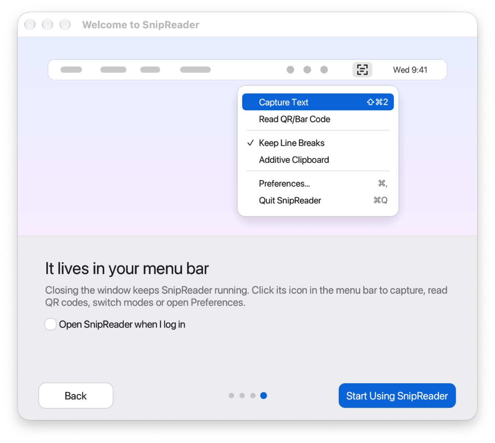

# SnipReader

**Grab text from anywhere on your Mac screen.** Press a shortcut, drag over any text (in an image, a video, a PDF, a screenshot, an app that won't let you select) and the text is in your clipboard.

Recognition runs on your Mac with Apple's Vision framework. Nothing is sent anywhere.



## Features

- **Capture Text** (default <kbd>⇧</kbd><kbd>⌘</kbd><kbd>2</kbd>): select an area, the text is copied.
- **Capture the same area again** without selecting it.
- **Read QR and bar codes**, and **read text from an image file**.
- **Keep Line Breaks** on or off: keep the layout, or get running text with paragraphs and hyphenated words joined back.
- **Additive Clipboard**: collect several captures into one clipboard text; optionally clear it when you paste.
- **Text to Speech** after a capture, with an adjustable rate.
- **Open links** found in the captured text (web and e-mail only).
- **Recognition languages**, automatic language detection and custom words.
- **Your own shortcuts** for every action.
- **Lives in the menu bar**; closing the window keeps it running.
- Clear status messages that show at a glance what happened:



## First launch

A short guide walks through the one permission SnipReader needs and how to use it. You can open it again from **Preferences → About → Show Welcome Guide…**

| | |
|---|---|
|  |  |
|  |  |

### Permissions

- **Screen Recording** (required): to read the area you select. *System Settings → Privacy & Security → Screen & System Audio Recording*. If macOS asks, quit and reopen SnipReader after switching it on.
- **Automation → System Events** (only for *Launch at Login*): to add SnipReader to your login items.
- **Input Monitoring** (only for *Additive Clipboard → Clear Automatically*): to notice ⌘V.

## Install

SnipReader is not notarized yet, so build it yourself (it takes a minute):

**Requirements:** macOS 11 or later (Apple silicon or Intel), [Rust](https://rustup.rs), and the Xcode Command Line Tools (`xcode-select --install`).

```bash
git clone https://github.com/<you>/snipreader.git
cd snipreader
./packaging/build_app.sh
cp -R dist/SnipReader.app /Applications/
```

`build_app.sh` builds a release binary, draws the app icon, assembles `dist/SnipReader.app` and signs it:

- with your **Apple Development** certificate if you have one (macOS then keeps the Screen Recording permission across rebuilds), or
- **ad-hoc** otherwise (macOS asks for the permission again after each rebuild). Pick a certificate with `SIGN_IDENTITY="<name or SHA-1>"`.

To run it straight from the source tree while developing: `cargo run`.

## How it works

1. A global shortcut (or the menu bar) starts `/usr/sbin/screencapture` in interactive mode.
2. The selected area goes to Apple Vision (`VNRecognizeTextRequest`, or `VNDetectBarcodesRequest` for codes). Recognition runs in a short-lived helper copy of the app, so Vision's models never stay in memory after a capture.
3. Recognized lines are sorted into reading order and joined (`src/layout.rs`), then copied with `pbcopy`.
4. A small HUD confirms the result. It is left out of screenshots, so it never ends up in a capture.

At rest, with the window closed, SnipReader uses about 60 MB of memory and no CPU.

| File | What it does |
|---|---|
| `src/main.rs` | Entry point, fonts, window size, the OCR helper switch |
| `src/app.rs` | Settings, the capture flow, main window state |
| `src/ui.rs` | Main window and HUD drawing |
| `src/onboarding.rs` | The first-launch welcome guide |
| `src/prefs.rs` | Preferences window |
| `src/ocr.rs` | Apple Vision text and code recognition, helper process |
| `src/layout.rs` | Reading order, paragraphs, line joining |
| `src/system.rs` | macOS glue: screen capture, clipboard, speech, links, windows |
| `src/keys.rs` / `src/tray.rs` | Shortcuts / menu bar icon and menu |
| `packaging/` | `build_app.sh`, `Info.plist`, icon drawing |

### Diagnostics

Each capture writes timestamped steps to `~/Library/Logs/SnipReader/timing.log` (reset at 512 KB), which shows which step took the time if a capture feels slow.

For development there are a few environment switches, for example `SNIPREADER_WELCOME_PAGE=2` to open the guide at a page, or `SNIPREADER_HUD="Copied to Clipboard" SNIPREADER_HUD_KIND=success SNIPREADER_SELFTEST=hold` to show a HUD. See the comments in `src/app.rs`.

## Contributing

Issues and pull requests are welcome. Please run `cargo test` and `cargo build` (no warnings) before sending a change.

## License

[MIT](LICENSE)
